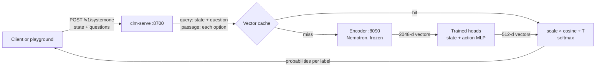
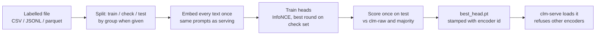

# 01 · System architecture

## Components

| Component | Code | Runs as | Purpose |
| --- | --- | --- | --- |
| Encoder server | `tools/local_embed_server.py` (default), or vLLM via `Claude Code/scripts/serve-encoder-gpu.sh` | Process on port 8090, `127.0.0.1` only | Turns text into L2-normalised vectors with the frozen Nemotron encoder. Nothing else. |
| CLM service | `src/clm/server.py` (`clm-serve`) | Process on port 8700, `127.0.0.1` by default | HTTP API, playground UI, head inference, training jobs |
| Engine | `src/clm/engine.py`, `heads.py`, `cache.py`, `embedder.py`, `schema.py` | Inside `clm-serve` | Builds the texts, gets vectors, applies the heads, returns probabilities |
| Encoder profiles | `src/clm/encoders.py` | Library | One definition of each encoder (id, width, prompts, truncation) shared by training and serving; the compatibility check |
| Trainer | `src/clm/trainer.py`, `train_cli.py` (`clm-train`), `train_jobs.py` (playground) | Library / CLI / background thread in `clm-serve` | Trains the two heads; the encoder is never changed |
| Playground | `src/clm/static/` | Browser | Ask, rank and train UI; talks only to `clm-serve` |
| Operations | `Claude Code/scripts/` | Shell | Setup, model download and verification, start, stop, status, tests |

## How a request flows

1. The caller sends a state (text or JSON) and one or more typed questions: yes/no
   (`noul`), pick one (`choice`) or ordered scale (`score`).
2. `schema.build_pairs` appends the question to the state and lists one candidate text per
   label (its description).
3. The embedder adds the encoder's prompts (`query: ` for the state, `passage: ` for
   candidates). It truncates with the encoder's tokenizer, keeping the end of a state and
   the start of a candidate, and checks the vector width.
4. The two heads project state and candidate vectors to 512 dimensions. The score is
   `exp(logit_scale) × cosine ÷ temperature`, and a softmax gives each label's probability.
5. With no head loaded, `clm-raw` uses the encoder's own vectors, with a fixed scale of 100.

Determinism: the same text, question and head always produce the same probabilities. The
encoder runs in bf16, so a different device can change the last decimal places.

## Training flow

Training from the playground embeds through `clm-serve`'s own embedder, so training and
serving vectors are produced by the same code path.

## Trust boundaries and security controls

| Boundary | Control | Where |
| --- | --- | --- |
| Network exposure | Both services bind to `127.0.0.1` by default. Exposing `clm-serve` needs `--host 0.0.0.0` and should be paired with `CLM_API_KEY`. | `server.py`, `local_embed_server.py` |
| Authentication | Optional bearer token (`CLM_API_KEY`) on all API and training routes. No user accounts. | `server.py` |
| Cross-origin use | CORS off by default (`--cors` to enable) | `server.py` |
| Uploads | Training uploads limited to 50 MB and to `.csv/.jsonl/.json/.parquet`. They are parsed as data only (no pickle) and stored under `--runs-dir/uploads/`. Upload ids are validated (no path traversal). | `train_jobs.py` |
| Model files | Heads loaded with `torch.load(weights_only=True)`, so a crafted file cannot run code. Release files are SHA-256-verified before unpacking. | `heads.py`, `fetch-models.sh` |
| Encoder/head mismatch | Every head records its encoder. Serving refuses mismatches and unrecorded heads. | `encoders.check_compatible` |
| Third-party calls | None at run time. After `fetch-models.sh` the stack runs with `HF_HUB_OFFLINE=1`. No telemetry. | `start.sh` |
| Resource use | One training job at a time; LRU caches with fixed sizes | `train_jobs.py`, `cache.py`, `embedder.py` |

## Where data is stored

| Data | Location | Retention |
| --- | --- | --- |
| Request texts | In memory only (LRU caches in `clm-serve` and the encoder) | Until evicted or restart. Not logged. |
| Training uploads | `runs/playground/uploads/` | Until deleted by an operator; no automatic expiry |
| Trained heads, metrics | `runs/playground/<job>/` (playground), `--out` (CLI) | Until deleted |
| Embedding cache for training | `runs/playground/embeddings/`, `OUT/embeddings/` | Until deleted. Contains vectors derived from uploaded texts. |
| Logs | `logs/encoder.log`, `logs/clm-serve.log` | Contain request counts and errors, not request texts |

Operators who load personal data must apply their own retention and deletion process to
`runs/`. See risk R9 in document 05.

## Deployment shapes

- **Laptop / single host (default):** both processes on one machine; encoder on Apple MPS,
  NVIDIA CUDA or CPU.
- **GPU server:** the 8B encoder behind vLLM (`serve-encoder-gpu.sh`). Heads must be trained
  on the 8B.
- **Not supported yet:** multi-instance serving with shared training state, and user-level
  access control. Treat `clm-serve` as a single-tenant service.
