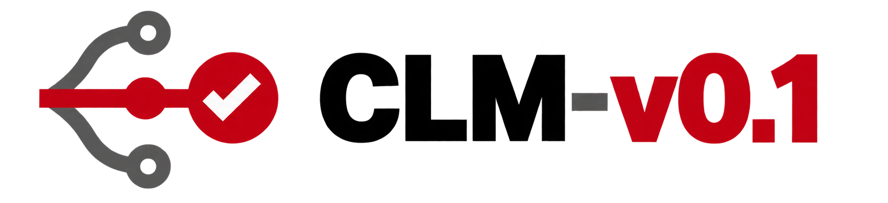

<p align="center"></p>

<h3 align="center">CLM on NVIDIA Nemotron</h3>
<p align="center"><i>Fast, cheap, private text classification you can train in a browser</i></p>

CLM (Contrastive Language Models) answers typed questions about a text: yes/no, pick one,
or a level on a scale. An NVIDIA Nemotron embedding model reads the text and never
changes. A small model on top learns **your** labels from **your** examples, in seconds to
minutes, and answers in tens of milliseconds on your own machine.

| Measured on a laptop (Apple M5 Pro) | |
| --- | --- |
| Accuracy, support-ticket routing, trained on 300 examples | **88–96%** on unseen tickets (57% untrained, 18% guessing) |
| Latency | **33 ms** median, 43 ms p95, per request |
| Throughput | **36** requests/s per laptop (about 3 million a day) |
| Cost per million decisions | about **$8** of compute, against $58–$2,320 for frontier models at list price |

Demo figures on synthetic data. Sources and caveats: [`Model Governance/04-evaluation.md`](Model%20Governance/04-evaluation.md).

## Start

**With Claude Code** (all you need): clone, open Claude Code in the folder, and type
**start the service**. It installs everything, downloads the models from this repo's
release and starts CLM. Then open <http://localhost:8700/>.

```bash
git clone https://github.com/rgvvvg5mpz-collab/clm-nemotron.git
```

**Without Claude Code:**

```bash
bash "Claude Code/scripts/start.sh"
```

Needs macOS (Apple silicon) or Linux, Python 3.10+, about 8 GB of free memory and 6 GB of
disk. No GPU required. Details: [`Claude Code/README.md`](Claude%20Code/README.md).

## Use it

- **Playground** (<http://localhost:8700/>): ask questions about any text with the shipped
  or your own models, and rank candidates. Every control has a tooltip.
- **Train a model** (switch at the top): upload a CSV of labelled examples, describe the
  labels, train, and check the results against two baselines. The model is served at once.
- **From code:** the same HTTP API, via the Python client or curl.

```python
from clm import CLMClient
r = CLMClient("http://localhost:8700").system_one(
    state="customer: my parcel never arrived",
    questions={"label": {"type": "choice", "instructions": "What is this conversation about?",
                         "criteria": {"billing": "A charge, invoice or payment problem.",
                                      "delivery": "Shipping or delivery of a physical item."}}},
    model="support-topic-1b")
print(r.answers["label"].choice)        # delivery
```

## What's in this repository

| Folder | For | Start with |
| --- | --- | --- |
| [`docs/`](docs/) | Everyone | [User guide](docs/USER_GUIDE.md) (step by step, with screenshots) · [Training](docs/TRAINING.md) · [API](docs/API.md) |
| [`Crew Training/`](Crew%20Training/) | New users and trainers | The 5-minute training video, exercises and a knowledge check |
| [`Marketing/`](Marketing/) | Executives | The briefing deck and 3-minute video (2:51): cost, accuracy, latency against frontier models |
| [`Model Governance/`](Model%20Governance/) | Risk, compliance, architecture | Architecture, model inventory and cards, data lineage, evaluation, risks, sourcing policy |
| [`Claude Code/`](Claude%20Code/) | Developers and operators | `scripts/`: setup, start, stop, status, tests, model release. `tools/`: builders for the videos, deck, screenshots and frontier benchmark |
| [`src/clm/`](src/clm/) | Developers | The product. Commands: `clm-serve` (API and playground), `clm-train`, `clm-encoder` (the Nemotron encoder server), `clm-benchmark` |
| [`tests/`](tests/) | Developers | `bash "Claude Code/scripts/test.sh"`: no GPU or network needed; CI runs it on every push |
| [`research/`](research/) | Researchers | Upstream's method and published results, agent-trace training, best-of-N evaluation, the T-Rex demo |

## Models

The repository is standalone: the models ship as assets of the GitHub release
[`models-v1`](https://github.com/rgvvvg5mpz-collab/clm-nemotron/releases/tag/models-v1).
They are verified by checksum on download and never fetched from third parties at run time.

| Model | What | Status |
| --- | --- | --- |
| `nemotron-3-embed-1b` | NVIDIA Nemotron-3-Embed-1B encoder (OpenMDW-1.1), built on Mistral AI's Ministral 3 | Default; in the release |
| `nemotron-3-embed-8b` | The 8B encoder, for NVIDIA GPU servers | Optional; from Hugging Face |
| `support-topic-1b` | Routes support conversations to 5 topics | Demo |
| `typed-decisions-1b` | Answers 15 business questions across 4 workflows | Demo |

The demo models were trained on synthetic data labelled by a model. Read
[Model Governance](Model%20Governance/README.md) before using any model for real decisions.

## Credits and licence

A fork of [Contrastive-LM/CLM](https://github.com/Contrastive-LM/CLM) by Jacky Kwok, Hangoo
Kang, Tarun Suresh, Jon Saad-Falcon, Marco Pavone, Christopher Ré and Azalia Mirhoseini.
This fork runs on NVIDIA's encoders instead of upstream's, adds training in the browser, a
model release, and the folders above. The method and upstream results are described in
[research/README.md](research/README.md). Code: Apache-2.0 ([LICENSE](LICENSE)). The Nemotron
encoder ships under OpenMDW-1.1, with its licence and notices inside the release archive.
