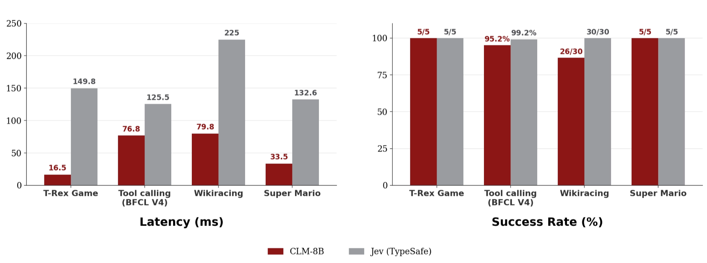
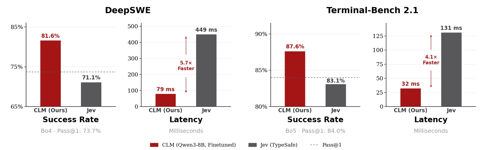

# CLM: the research behind it

This page keeps the upstream project's description of Contrastive Language Models: the
method, the published results, the data recipe and the scaling laws. It is credited to the
authors below.

> **Read the results with care.** Every number on this page was measured by the upstream
> authors with their released head on a *different* encoder. This fork runs on NVIDIA
> Nemotron, and its heads are trained from scratch, so these figures don't carry over.
> Measurements of this fork are in the [user guide](USER_GUIDE.md), in
> [Model Governance](../Model%20Governance/README.md) and in [Marketing](../Marketing/README.md).

Upstream: [github.com/Contrastive-LM/CLM](https://github.com/Contrastive-LM/CLM) ·
[blog](https://contrastive-lm.notion.site) · Apache-2.0.

## Results

### Zero-shot evaluation

<p align="center">
  
</p>

Across **computer-use, gaming and tool-calling tasks**, CLM-8B performs on par
with Jev while running **up to 9× faster**. The speedups are largest when the
number of candidate actions is large (WikiRacing) or when actions are reused
across states (the T-Rex game). The T-Rex benchmark ships in this repo:
see [examples/t_rex](../examples/t_rex/README.md).

### Agentic benchmarks: CLM as a verifier

<p align="center">
  
</p>

For each task we sample several candidate solutions (**Opus 5** for DeepSWE,
**Fable 5** for Terminal-Bench 2.1), and CLM or Jev acts as the verifier that
picks the best one. Evaluated on **38 held-out DeepSWE tasks** and **30
held-out Terminal-Bench 2.1 tasks**; latency on an H100. Jev fails to serve as
a verifier for these long-horizon tasks, scoring below pass@1. With lightweight
fine-tuning, CLM reaches SOTA on both (**81.6%** and **87.6%**) while running
**4.1–5.7× faster than Jev**.

## How it works

### About

CLM first trains a **state encoder** and an **action encoder** on a
large-scale dataset with a contrastive objective (InfoNCE), so that each state
is pulled toward the ground-truth action that was taken and pushed away from
all others. The two encoders then serve directly as a zero-shot action
classifier: at deployment, given the current state and a set of candidate
actions, CLM scores each action by how well its embedding aligns with the
state embedding and selects the highest-scoring action.

That is what this package serves. A typed question is a state plus a closed
set of candidate actions (the options and their descriptions); a softmax over
CLM's scores *is* the answer distribution, and the same call ranks best-of-N
trajectories, routes tools, shortlists retrieval pools and answers typed
decisions with no per-task setup.

**Architecture, data recipe and scaling laws:**

- Each encoder is a frozen LLM backbone plus a 20M-parameter trainable
  projection head, so inference is one
  embedding per fresh text and a dot product per cached candidate.
- CLM is **pre-trained** on internet-scale Q&A, **mid-trained** on synthetic
  hard negatives, **post-trained** on agentic traces, and can be easily
  fine-tuned on downstream tasks ([data recipe](#data-recipe)).
- The InfoNCE loss **decreases predictably as a power law** in training
  compute, model size and dataset size ([details](#scaling-laws-for-verification)).

```
browser ──► clm-serve  (CPU, :8700)   GET / (playground)
client  ──►                          POST /v1/systemone · GET /v1/models · GET /health
               │       state head + action head (20M params, hot-reloaded), embedding cache
               ▼
          vLLM Nemotron-3-Embed-8B pooling server (GPU, :8090)   /v1/embeddings
```

### Training Algorithm

CLM is trained with a bidirectional InfoNCE loss. Given a batch of $B$
matched state–action pairs, we compute a $B \times B$ similarity matrix and,
for each positive pair $(s_i, a_i)$, optimize retrieval in both directions
($s_i \rightarrow a_i$ and $a_i \rightarrow s_i$):

```math
L_{\mathrm{CLM}} = -\frac{1}{2B}\sum_i \left[ \log \frac{\exp\left(s_i^\top a_i/\tau\right)} {\sum_j \exp\left(s_i^\top a_j/\tau\right)} + \log \frac{\exp\left(a_i^\top s_i/\tau\right)} {\sum_j \exp\left(a_i^\top s_j/\tau\right)} \right]
```

For mid-training, the objective is extended with hard negatives. Let
$h_{ik}^{(a)}$ denote a hard negative action for state $s_i$; the
state-to-action direction becomes

```math
L_{s \rightarrow a}^{\mathrm{hard}}=-\frac{1}{B}\sum_i\log\frac{\exp\left(s_i^\top a_i / \tau\right)}{\exp\left(s_i^\top a_i / \tau\right)+\sum_k\exp\left(s_i^\top h_{ik}^{(a)} / \tau\right)}.
```

### Scaling Laws for Verification

The test InfoNCE loss $L$ scales as a power law with training compute $C$,
dataset size $D$, projection-head size $N$ and encoder size
$N_{\mathrm{enc}}$. These dimensions must be scaled jointly for the best
verification performance; when a scale factor is not bottlenecked by the
others, the dependence on each variable $`X \in \{C, D, N, N_{\mathrm{enc}}\}`$
is

```math
L(X) \approx \left(\frac{X_c}{X}\right)^{\alpha_X},
```

where $X_c$ is a fitted scale constant and $\alpha_X$ the corresponding
scaling exponent, following Kaplan et al. Scaling the encoder size yields the
strongest gains. Experiments are conducted on the Nemotron DQA dataset and
evaluated on a held-out set; the fits and figures are in the
[blog post](https://contrastive-lm.notion.site).

**Data vs. optimal model size.** At a fixed compute budget, each iso-FLOP
curve of test loss against head size is well approximated by a parabola in
log-parameter space, and its minimum gives the optimal head size for that data
budget. The optimum grows almost exactly linearly with the number of training
tokens, $N^* \propto D^{1.02}$, at roughly **310 tokens per parameter**.

### Data Recipe

CLM is trained in three stages, each a progressively harder form of
state–action alignment:

1. **Pre-training** on **~60M Nemotron DQA question–answer pairs**, each
   question the state and its answer the action. This learns broad semantic
   representations.
2. **Mid-training** on **~30M synthetic hard negatives** generated by Gemini
   2.5 Flash-Lite: semantically similar but incorrect answers to Nemotron DQA
   questions, added to the InfoNCE loss as above. This develops fine-grained
   discrimination between plausible actions.
3. **Post-training** on **~1M agent trajectories** from the Agent Data
   Protocol (ADP) dataset, plus terminal traces from Endless-Terminals and
   LiteCoder-Terminal-SFT. Each trajectory step is a state–action pair: the
   agent's current context and the decision it took.

**Replay during post-training.** 40% of the post-training mixture is Nemotron
DQA replay and 60% agentic trajectories. With replay, Nemotron hard-negative
top-1 accuracy only moves from 69% to 68.5%; training on agentic data alone for
the same number of agentic steps drops it to 56.2%.

**Why not train on hard negatives from the start?** On ~100K held-out
questions (one gold answer, 10 hard negatives each), pre-training alone reaches
**52.1%** top-1 without seeing a hard negative, and a short mid-training stage
lifts it to **69.2%**. Training with hard negatives from the start improves
quickly but peaks at **62.4%** before overfitting, so the two-stage recipe is
**7 points better** at a fixed budget: hard negatives work best as a refinement
on top of pre-training, not a substitute for it.

There is no default head in this fork. Any head in the CLM checkpoint format,
trained on the configured encoder, can be served with `--ckpt`. The format is a `torch.save` dict with `state_head` /
`action_head` state dicts, `logit_scale` and `cfg` (`width`, `depth`,
`projection_dim`, `activation`, `layernorm`, `residual`, `hidden_size`,
`encoder`). A head only makes sense with the encoder it was trained against.
`cfg["encoder"]` records that encoder, and `clm-serve` refuses a mismatch or a
checkpoint that records none (upstream releases).

## Upstream roadmap

1. **Scaling experiments:** larger backbones, and how far verification
   performance keeps scaling.
2. **Vision and multimodal support:** images, video and other modalities for
   robotics and computer-use tasks.
3. **Scaling the data recipe:** more pre-training, hard-negative mining and
   agentic post-training.

## Citation

If you find CLM useful, please consider citing it:

```bibtex
@misc{kwok2026contrastivelanguagemodels,
  title={Contrastive Language Models},
  author={Jacky Kwok and Hangoo Kang and Tarun Suresh and Jon Saad-Falcon and Marco Pavone and Christopher Ré and Azalia Mirhoseini},
  year={2026},
  note={Notion Blog},
  url={https://contrastive-lm.notion.site}
}
```
