# CLM user guide

How to start CLM, ask it questions, train a classifier on your own labelled examples, and
decide whether that classifier is good enough to use. No programming needed until the
"Use a model from code" section.

Prefer video? Watch the five-minute walkthrough in
[`Crew Training/CLM-Crew-Training.mp4`](../Crew%20Training/CLM-Crew-Training.mp4).

**Contents**

1. [What CLM does, in two minutes](#1-what-clm-does-in-two-minutes)
2. [Start and stop CLM](#2-start-and-stop-clm)
3. [Find your way around](#3-find-your-way-around)
4. [Ask questions about a text](#4-ask-questions-about-a-text)
5. [Rank a list of candidates](#5-rank-a-list-of-candidates)
6. [Train a model on your own labels](#6-train-a-model-on-your-own-labels)
7. [Use a model from code](#7-use-a-model-from-code)
8. [Improve accuracy](#8-improve-accuracy)
9. [Manage your models](#9-manage-your-models)
10. [Before you use a model for real decisions](#10-before-you-use-a-model-for-real-decisions)
11. [Troubleshooting](#11-troubleshooting)
12. [Glossary](#12-glossary)

---

## 1. What CLM does, in two minutes

You give CLM a piece of text (the **state**) and ask it **typed questions** about it:

| Question type | Example | Answer |
| --- | --- | --- |
| **Yes or no** (`noul`) | "This customer needs a human agent." | The probability that it's true, e.g. 82% |
| **Pick one** (`choice`) | "Which team should handle this?" with options billing, technical, account | The most likely option, plus a probability for each |
| **Scale** (`score`) | "How urgent is this?" from *None* to *Critical* | The expected level, e.g. 2.3 on a 0–3 scale |

Under the hood, NVIDIA's Nemotron model reads the text and each option's description and
turns them into numbers; it is never changed. On top of it sit small **trained models**
(also called heads) that learn *your* labels from *your* examples. Training takes seconds
to minutes; answers take tens of milliseconds; everything runs on your machine.

**Use CLM for** routing, tagging, triage and yes/no checks where the labels are fixed and
you have examples. **Use a large language model instead for** open-ended questions,
writing, summarising and multi-step reasoning.

---

## 2. Start and stop CLM

### With Claude Code (recommended)

1. Clone the repository and open Claude Code in it:

   ```bash
   git clone https://github.com/rgvvvg5mpz-collab/clm-nemotron.git
   cd clm-nemotron
   claude
   ```

2. Type **start the service**. The first time, Claude installs CLM and downloads the
   models from the repository's release (about 2.4 GB, a few minutes). If it asks you to
   sign in to GitHub, run `gh auth login` once.
3. When it says **running**, open <http://localhost:8700/>.

Later you can ask Claude **is it running?** or **stop the service**.

### Without Claude Code

From the repository folder:

```bash
bash "Claude Code/scripts/start.sh"
```

```bash
bash "Claude Code/scripts/status.sh"
```

```bash
bash "Claude Code/scripts/stop.sh"
```

**What you need:** a Mac with Apple silicon, or Linux (Windows through WSL2); Python 3.10
or newer; about 8 GB of free memory and 6 GB of disk. No NVIDIA GPU is required.

---

## 3. Find your way around

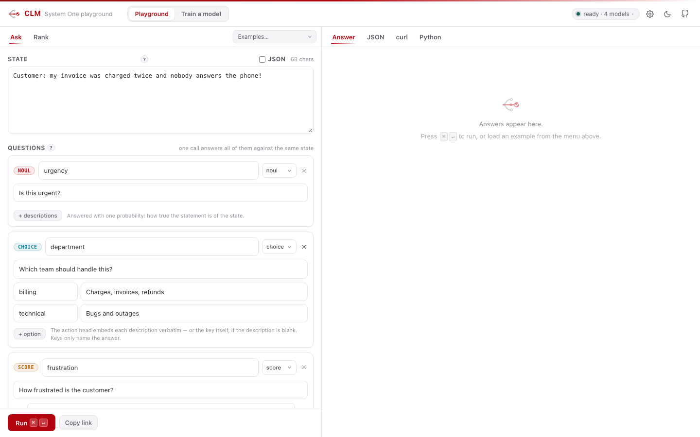

| Area | What it is |
| --- | --- |
| **Playground / Train a model** (top) | Switch between asking questions and training your own model |
| **Status light** (top right) | Green: ready, with the number of models loaded. Click it to see each model, what it answers, its test accuracy and which is the default; click a model to use it. **Check again** re-asks the server. |
| **Gear** | Connection settings: another server's address, and an API key if the server needs one |
| **Moon** | Light or dark theme |
| **Left pane** | Your text and your questions |
| **Right pane** | The answers |

**Every control has a tooltip.** Hover over it, or tab to it with the keyboard. Small **?**
buttons explain terms; on a touch screen, tap them.

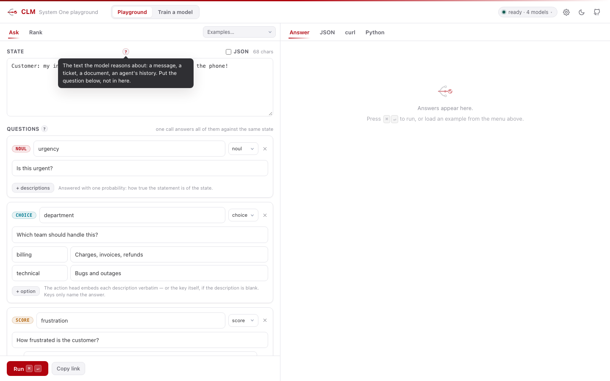

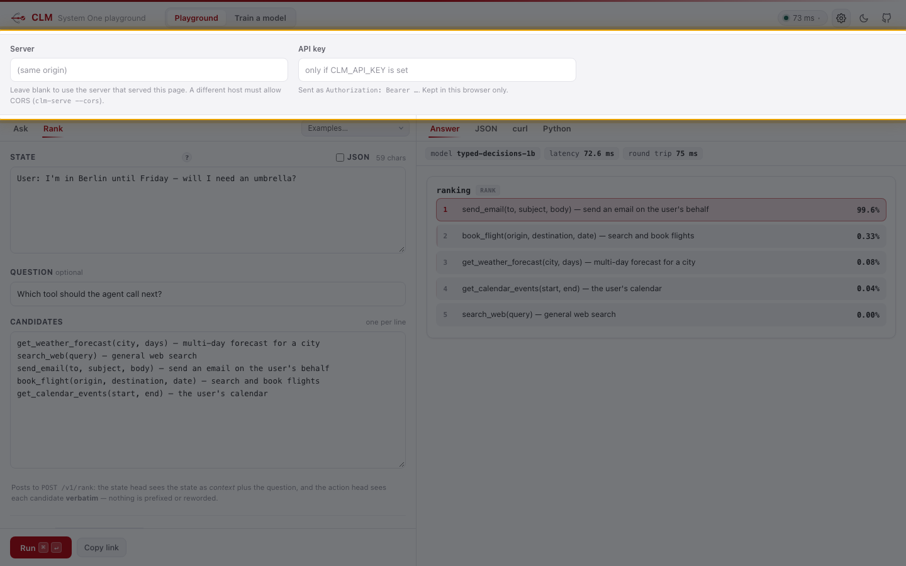

---

## 4. Ask questions about a text

1. **Pick an example** from **Examples…** to see a ready-made request, or start from the one shown.
2. **Type or paste your text** in **State**. Put the context here, not the question.
3. **Write your questions** below it. Use **+ noul**, **+ choice** or **+ score** to add one:
   - **noul (yes/no):** write a statement, such as "Is this urgent?". Optionally use
     **+ descriptions** to say what a *true* and a *false* case look like.
   - **choice:** write the question, then one option per row. The **key** (left) is the name
     you get back. The **description** (right) is what the model reads, so make it describe the option.
   - **score:** write what's being rated, then the levels from lowest to highest.
4. **Choose a model** under **Model**. `clm-raw` uses no training: good for trying wordings,
   not for decisions. Other names are trained models.
5. Press **Run** (or Cmd/Ctrl + Enter).

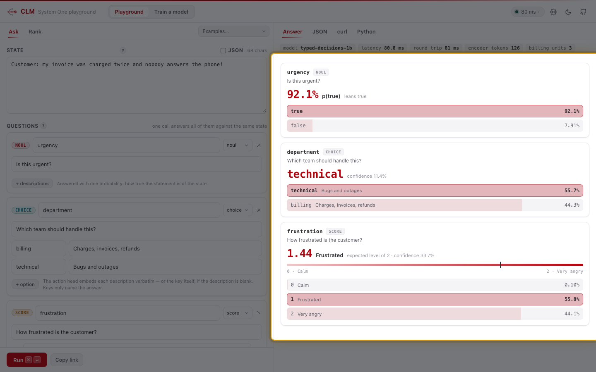

**Reading the answers.** Each question gets a card. The highlighted bar is the model's
answer, and the percentage is its probability. For scales, the needle shows the expected
level. **Treat the percentages as a ranking, not a guarantee**, until the model has been
calibrated (section 10).

The **JSON** tab shows exactly what the server returned. **curl** and **Python** show the
same request as code a developer can copy.

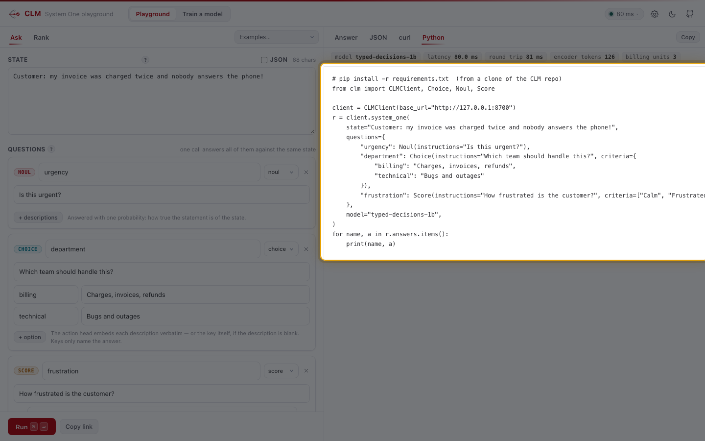

**Copy link** puts a link to this exact request on your clipboard.

---

## 5. Rank a list of candidates

Use **Rank** when the options aren't a fixed set: tools to call, documents, answers to choose from.

1. Open the **Rank** tab.
2. Put the context in **State**, an optional question in **Question**, and one candidate per line.
3. Press **Run**. Candidates come back best first.

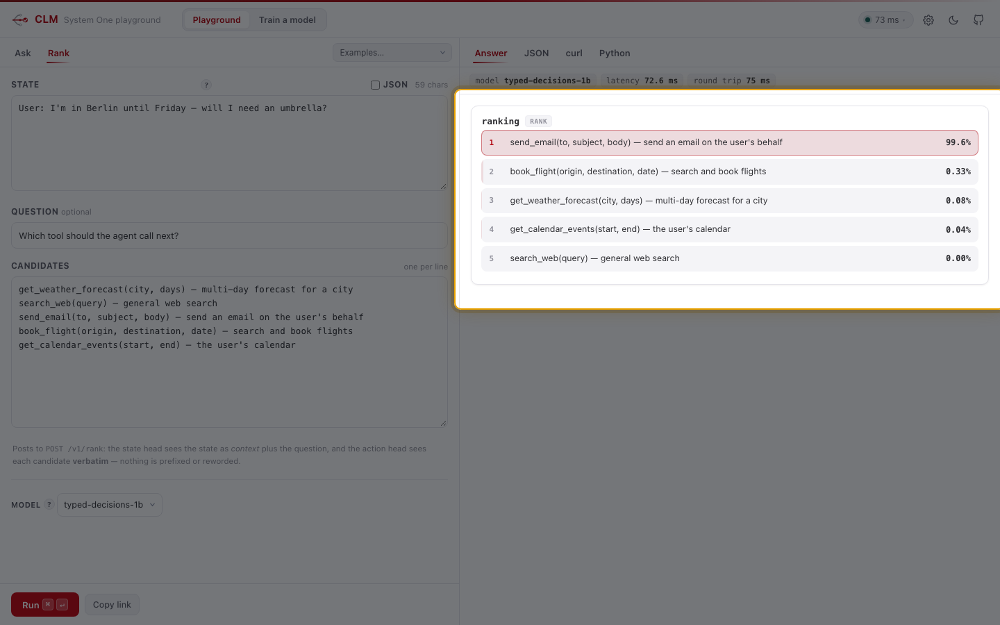

---

## 6. Train a model on your own labels

Open **Train a model** at the top. The page walks you through four steps; each unlocks
when the one before is done.

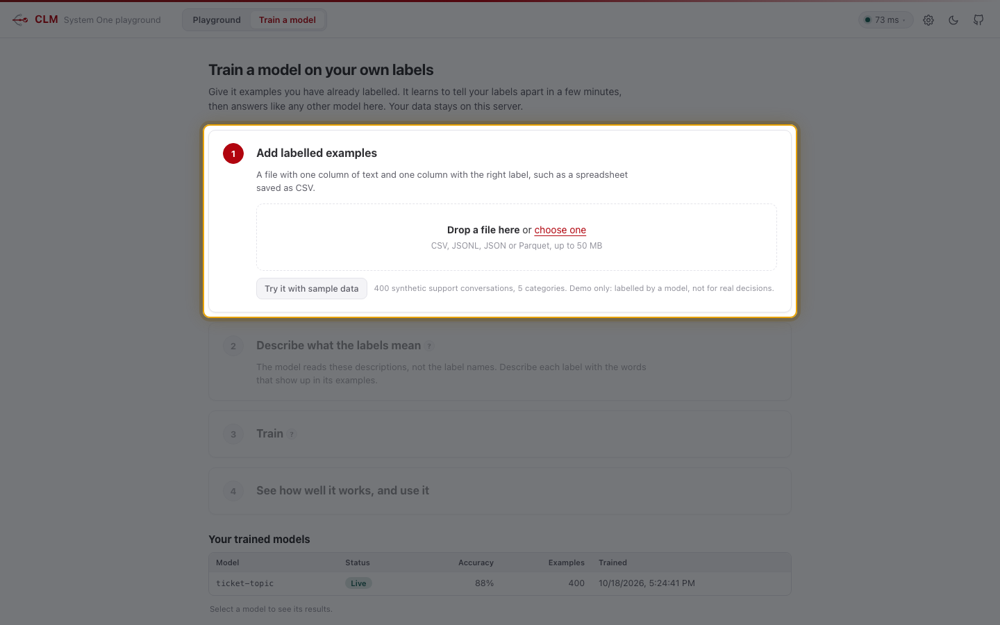

### Step 1: Add labelled examples

**Prepare a file** with one column of text and one column with the right label for each row.

```csv
text,label,customer
"I was charged twice for March",billing,C-1042
"The app crashes when I log in",technical,C-0007
"My parcel never arrived",delivery,C-0311
```

- **Formats:** CSV (save a spreadsheet as CSV), JSONL, JSON or Parquet, up to 50 MB.
- **How many:** at least 30 examples per label; a few hundred in total is a good start.
- **Quality:** labels checked by people. The model learns whatever the labels say, including mistakes.
- **Optional:** a column that groups rows, such as a customer or case ID (see "Group by" below).
- **Optional:** a `split` column with `train` or `test` on each row, if you want to choose the test rows yourself.

**Load it:** drop the file onto the box, or click **choose one**. To try the whole flow
first, click **Try it with sample data**: 400 synthetic support conversations in five
categories (demo only).

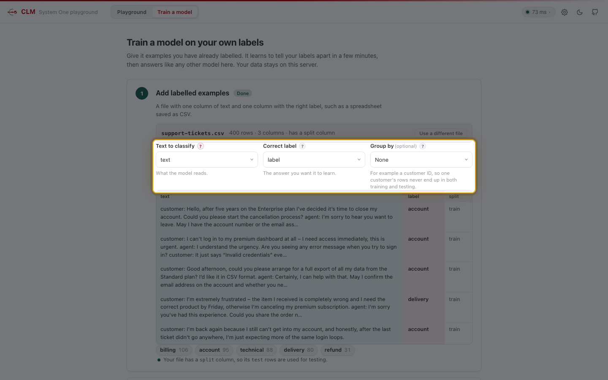

**Check what CLM found:**

- **Text to classify** and **Correct label** are picked for you. Change them if they're wrong.
  In the preview, the text column is shaded teal and the label column red.
- **Group by** (optional): pick the customer or case column if several rows come from the
  same source. Their rows then stay together, so the test never contains near-copies of
  training rows, and the score stays honest.
- **The chips** show each label and how many examples it has. Labels with fewer than 10
  are flagged, and so is a label that dominates the data.

### Step 2: Describe what the labels mean

**This step matters most.** The model doesn't read your label names. It compares each
text with your **descriptions**.

1. **Write the question** the labels answer, such as "What is this customer conversation
   primarily about?". It's asked about every example.
2. **Pick the kind of answer.** *Pick one label* for most data. *Yes or no* is offered when
   your labels are true/false or yes/no.
3. **Describe each label in one sentence**, using the words and situations that appear in
   its examples.

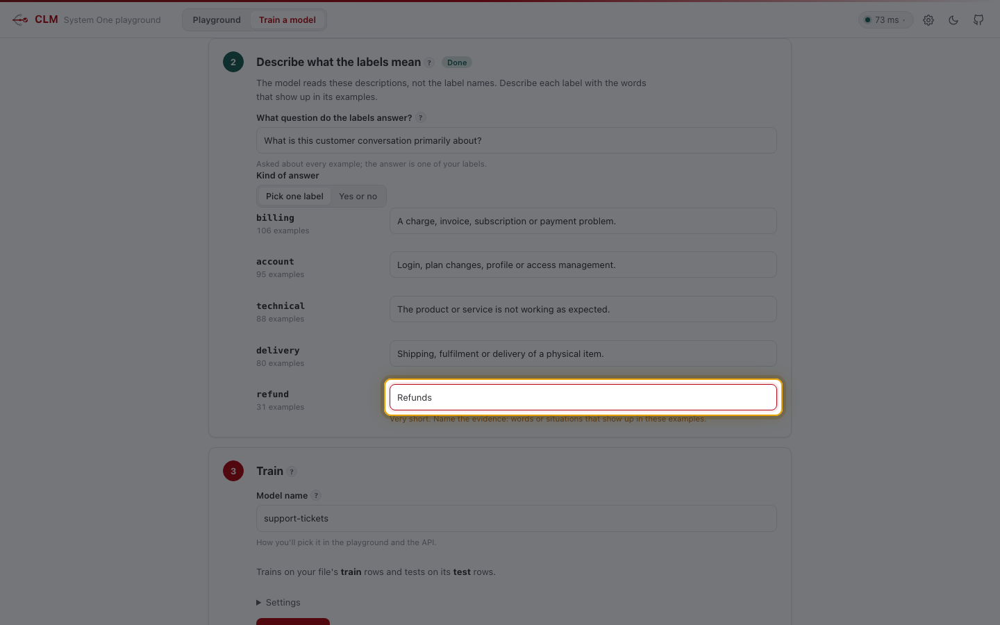

The page checks your descriptions as you type:

| Hint | What to do |
| --- | --- |
| *Not described yet* | Write a description; the label name alone works poorly |
| *Very short* | Name the evidence: what do these texts actually say? |
| *Same as “…”* | Make each description different from the others |
| *Catch-all wording* | Drop words like "other" or "general"; describe the actual content |

| Weak | Strong |
| --- | --- |
| billing: "Billing department" | billing: "A charge, invoice, subscription or payment problem." |
| other: "Other" | *(no catch-all: if you need one, train a separate yes/no question)* |

### Step 3: Train

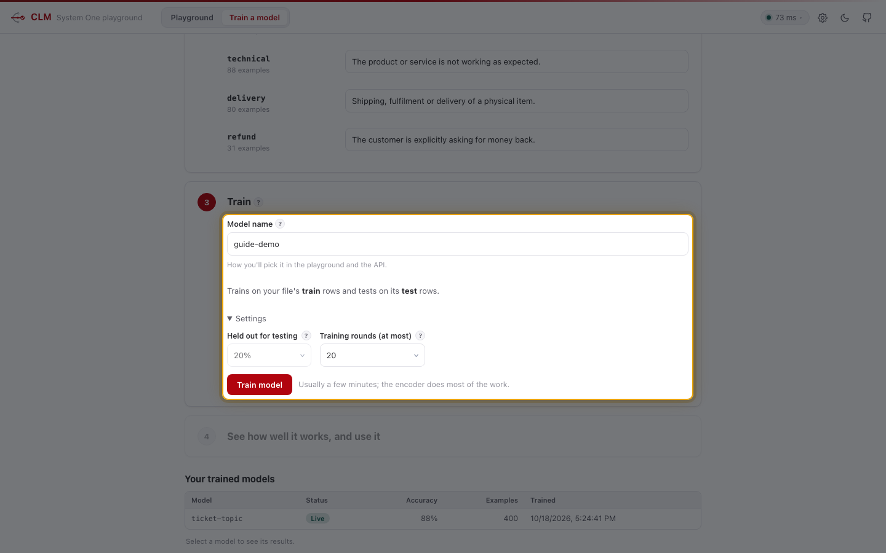

1. **Name the model.** It's how you'll pick it later; letters, numbers and dashes.
2. **Check the split sentence.** By default 20% of the examples are held back for testing
   (or your file's `test` rows are used). The model never sees them while training.
3. **Settings** (optional): the share held out for testing (10–30%) and the maximum number
   of training rounds. The defaults suit most data.
4. Press **Train model**.

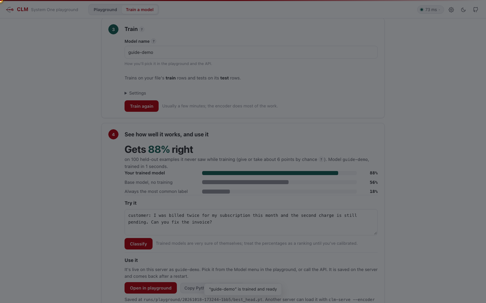

**What happens:** the Nemotron encoder reads every text once (*Reading the texts*). Then
the small trained model learns in rounds (*Training*). The line shows accuracy on a
**check set**, a slice of the training data it doesn't learn from. The dashed line is
where it started, without training. Training stops by itself when it stops improving, and
keeps the best round. You can keep using the playground meanwhile, or press **Stop
training**.

### Step 4: See how well it works, and use it

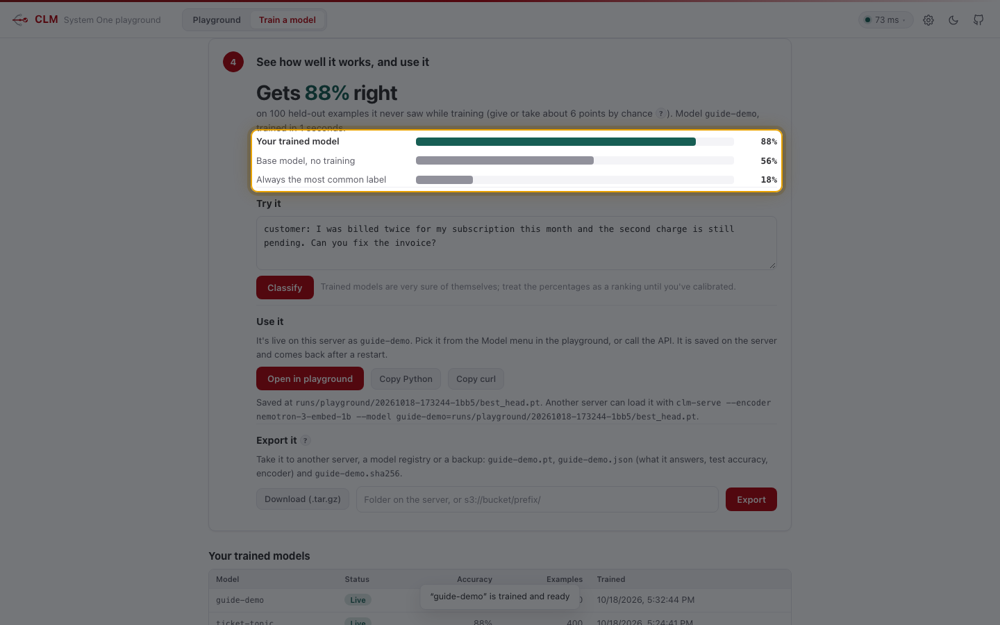

**Read the result in this order:**

1. **The headline:** how many **held-out** examples, which it never saw, it gets right.
2. **The two baselines below it:**
   - *Base model, no training*: the encoder alone, comparing texts with your descriptions.
   - *Always the most common label*: what you'd get by always giving the most frequent answer.

   **A useful model clearly beats both.** If it doesn't, the page says so; see section 8.
3. **The margin of chance:** "give or take about N points". With 100 test examples, a
   difference of a few points means nothing. Retraining on the same data can also land a
   few points higher or lower.

**Try it** on a new example before you trust it: paste text and press **Classify**.

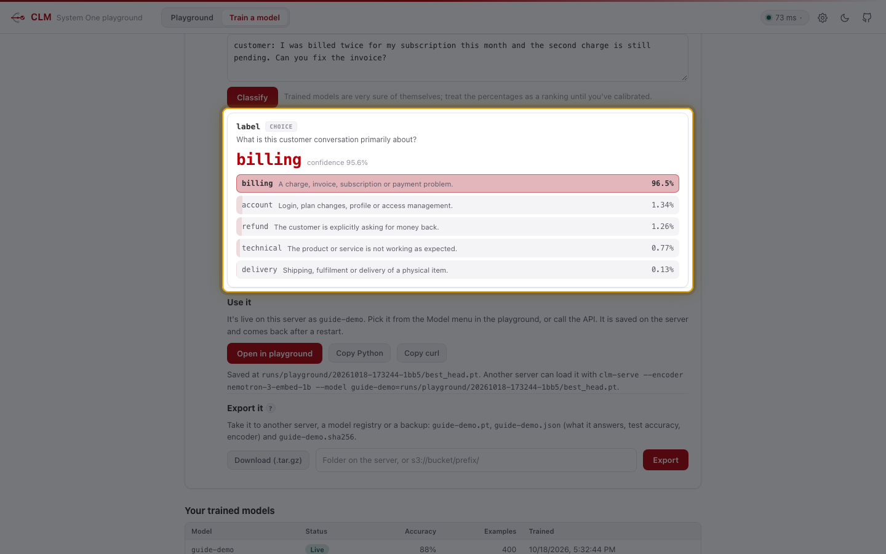

**Use it:**

- It's **already live** on this server under its name. **Open in playground** loads it
  with its question, ready to run.
- **Copy Python** and **Copy curl** give a developer working code.
- It's saved, and comes back after a restart.

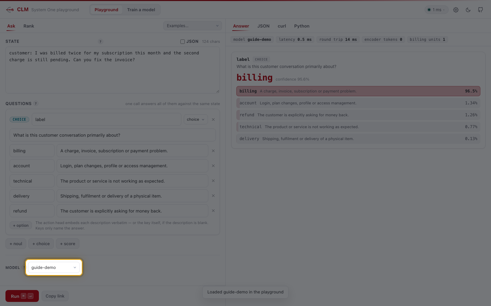

**Export it** to take the model somewhere else: another CLM server, a model registry, a
backup. An export is three files: `NAME.pt` (the model), `NAME.json` (its card: which
encoder it needs, its questions and labels, its test accuracy) and `NAME.sha256`
(checksums).

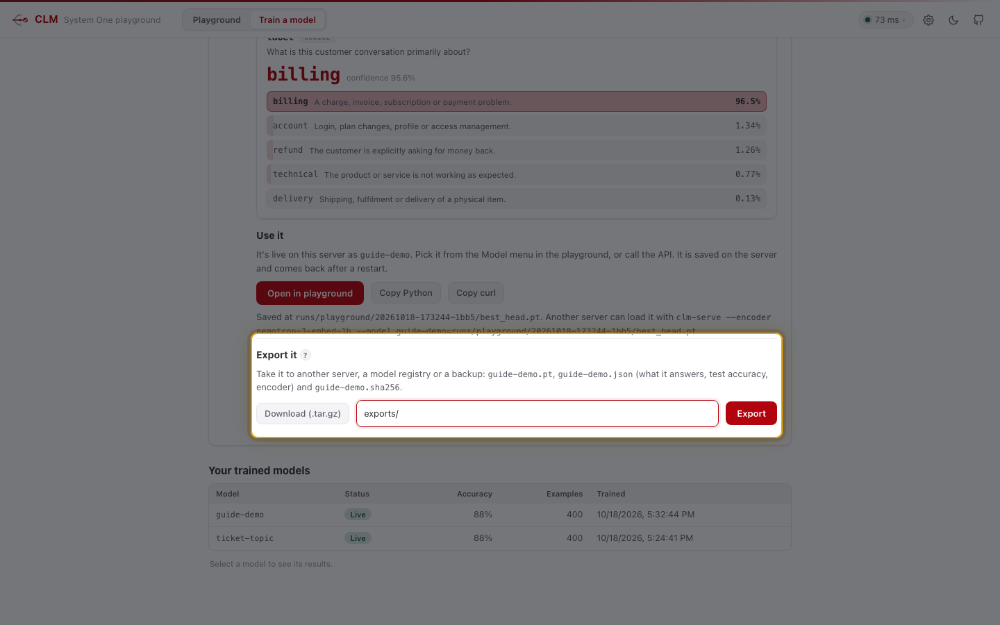

- **Download (.tar.gz)** saves the three files to your computer.
- Type a **folder on the server** (for example `exports/`) or an **S3 location**
  (`s3://my-bucket/clm/models/`) and press **Export**. S3 uses the server's AWS
  credentials; the page lists each file it wrote.
- The **↓** beside any model in the status-light list downloads that model the same way.
- With Claude Code: *export ticket-topic to s3://my-bucket/clm/models/*.

---

## 7. Use a model from code

Every trained model answers the same HTTP API. Send the question it was trained with:
the playground's **Copy Python** button gives you the exact code. For example:

```python
from clm import CLMClient

client = CLMClient("http://localhost:8700")
r = client.system_one(
    state="customer: I was charged twice this month",
    questions={"label": {"type": "choice",
                         "instructions": "What is this customer conversation primarily about?",
                         "criteria": {"billing": "A charge, invoice, subscription or payment problem.",
                                      "delivery": "Shipping, fulfilment or delivery of a physical item."}}},
    model="guide-demo",
)
print(r.answers["label"].choice, r.answers["label"].probabilities)
```

- **Always send the same question and descriptions** the model was trained with. They're
  saved next to the model as `questions.json`, and the copy buttons include them.
- The full API is in [API.md](API.md). Training from the command line or a script
  (`clm-train`) is in [TRAINING.md](TRAINING.md).

---

## 8. Improve accuracy

| Symptom | Likely cause | Fix |
| --- | --- | --- |
| Doesn't beat "always the most common label" | Descriptions too vague, or one label dominates | Rewrite descriptions with evidence words; add examples of the rare labels |
| The right label is usually second | Two descriptions overlap | Make them mutually exclusive, or merge the labels |
| Good score, but wrong on real messages | Test rows were near-copies of training rows | Use **Group by**; test on newer data |
| One label is never chosen | Too few examples, or a vague description | Add examples (30+), sharpen its description |
| Percentages always near 100% | Normal for trained models | Treat as a ranking; calibrate before using thresholds (section 10) |
| Long texts go wrong | Very long texts are cut, keeping their end | Put what decides the label near the end; trim boilerplate |
| Results differ a little between trainings | Small data | Normal: a few points. Same data and settings give the same result. |

**Good habits:** labels checked by people; at least 30 examples per label; group by
customer or case; distinct descriptions; retrain whenever labels, their wording or your
data sources change.

---

## 9. Manage your models

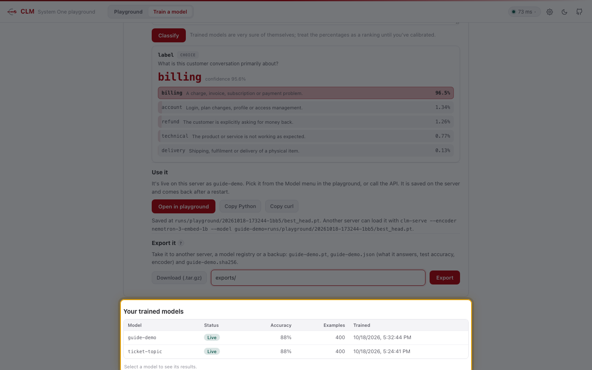

- **Your trained models** (bottom of the Train page) lists every model trained here.
  Select one to see its results again. *Live* means it's answering requests.
- **Where they're stored:** `runs/playground/<date-time>/` on the server: the model
  (`best_head.pt`), its question (`questions.json`) and its scores (`summary.json`).
- **Models that ship with CLM** (`support-topic-1b`, `typed-decisions-1b`) are in
  `models/heads/`. They're demos.
- **To retire a model:** stop the service, delete its folder in `runs/playground/`, start again.
- **To share a model** with another CLM server: export it (section 6, Step 4, or ask
  Claude Code to *export NAME to DEST*), copy `NAME.pt` over, and start that server with
  `--model NAME=path/to/NAME.pt`. It must use the same encoder; the card says which, and
  CLM refuses a mismatch. `shasum -a 256 -c NAME.sha256` checks the copy arrived intact.

---

## 10. Before you use a model for real decisions

The models that ship with CLM, and anything trained on the sample, are **demos**:
synthetic data labelled by a model. Before a model you train makes real decisions:

1. **Train and test on real, human-labelled data**, grouped by customer or case.
2. **Calibrate.** Fit a temperature on validation data so a 90% answer is right about 90%
   of the time, and choose thresholds from validation data, not by guessing.
3. **Spot-check** at least 50 recent real examples labelled by people.
4. **Complete the [new model checklist](../Model%20Governance/templates/new-model-checklist.md)**
   and register the model in [Model Governance](../Model%20Governance/README.md).
5. **Don't** use it for decisions with legal or similar effects on people without human
   review and fairness testing.

---

## 11. Troubleshooting

| You see | Do this |
| --- | --- |
| The page doesn't load | Ask Claude "is it running?" or run `status.sh`; start it if needed |
| Status says **encoder down** | The encoder stopped. Ask Claude to restart the service; check `logs/encoder.log`. |
| Status says **no head (clm-raw)** | No trained model is loaded. Train one, or check that `models/` was downloaded. |
| "Couldn't use that file" | Check the format and that it has named columns; the message says what's wrong |
| "describe every label; missing: …" | A label in your file has no description row; reload the file |
| "need at least 10 training and 2 test examples" | Add data, or lower the test share in **Settings** |
| "… is still training" | One training runs at a time. Wait, or press **Stop training**. |
| A model shows **Not loaded** | It was trained with a different encoder than the server runs |
| 401 error | The server requires an API key: set it with the gear icon |

More operational detail: [`Claude Code/RUNBOOK.md`](../Claude%20Code/RUNBOOK.md).

---

## 12. Glossary

| Term | Meaning |
| --- | --- |
| **State** | The text (or JSON) the model reasons about |
| **Question** | What you ask about the state: yes/no (`noul`), pick one (`choice`) or scale (`score`) |
| **Label / option** | One possible answer to a question |
| **Description** | The sentence that explains a label; what the model actually compares with the text |
| **Encoder** | NVIDIA Nemotron, which turns text into numbers; never changed by training |
| **Head / trained model** | The small networks trained on your labels |
| **`clm-raw`** | Answers from the encoder alone, without training; for trying things, not decisions |
| **Held-out / test examples** | Labelled examples kept away from training and used once to score the model |
| **Check set** | Part of the training examples used to pick the best training round |
| **Baseline** | A simple reference result the model must beat |
| **Calibration** | Adjusting probabilities so that "90%" means right about 90% of the time |
| **Group by** | Keeping rows from the same customer or case on one side of the split |
